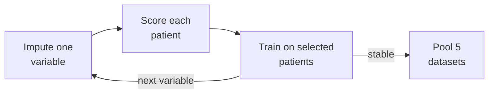
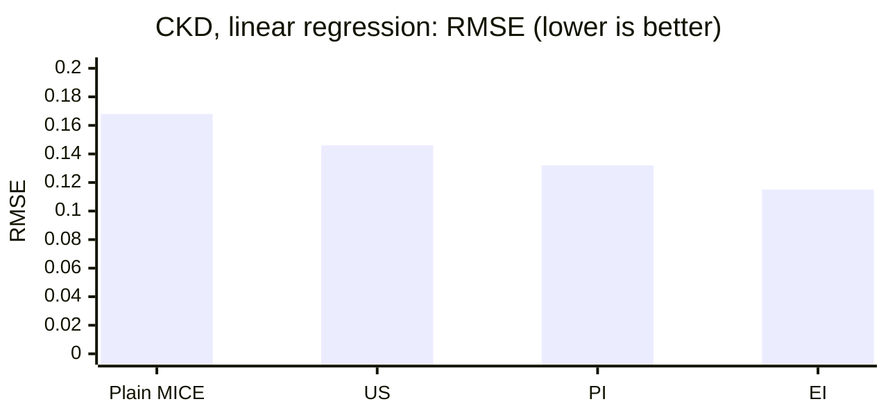

The method from our paper [Uncertainty Aware Approach for Multiple Imputation Using Conventional and Machine Learning Models]() is now a Python package. Romen Samuel Rodis Wabina, the first author, wrote and maintains it.

<!--more-->

## The problem

Our hospital cohorts had many missing laboratory values:

| Cohort | Patients | Missing per variable |
| --- | --- | --- |
| Chronic kidney disease (CKD) | 31,043 | 4% to 49% |
| Hypertension, Ramathibodi (HT-RAMA) | 140,047 | 16% to 53% |
| Hypertension, Khon Kaen (HT-KKU) | 108,942 | 28% to 68% |

MICE, the usual method, fills one variable at a time from earlier filled values. An early error therefore moves into every later step.

## The method

We kept MICE and changed what each model trains on. An uncertainty function scores how much each patient's imputed values vary across imputations. Each model then trains only on the patients the function selects.



| Function | Selects patients with |
| --- | --- |
| Uncertainty sampling (US) | the lowest variance |
| Probability of improvement (PI) | the highest chance to improve the current best value |
| Expected improvement (EI) | the largest expected improvement |

We tested each function with linear regression, decision tree, random forest and XGBoost. To get known true values, we removed values from 8,156 complete CKD records in the real missing patterns, then imputed them again.

## Results

In CKD, every function lowered the error of linear regression:



Linear regression was the best model in all three cohorts:

| Cohort | Best | RMSE | MAE |
| --- | --- | --- | --- |
| CKD | Linear regression + EI | 0.12 | 0.36 |
| HT-RAMA | Linear regression + US | 0.24 | 8.15 |
| HT-KKU | Linear regression + US | 0.98 | 12.00 |

The functions also kept imputed distributions close to the observed data. XGBoost was the exception: it did not improve and needed long tuning.

## Use it

```bash
pip install uncertainty-imputation
```

```python
from uncertainty_imputation import UncertaintyImputer

imputer = UncertaintyImputer(model="linear", acquisition="ei")
X_imputed = imputer.fit_transform(X_missing)  # DataFrame or array
scores = imputer.uncertainty_  # score per imputed cell
```

The `acquisition` key is `us`, `pi` or `ei`. The package also makes MCAR, MAR or MNAR test data, so you can repeat our test design on your own data. It needs Python 3.9 or later.

[PyPI](https://pypi.org/project/uncertainty-imputation/) · [Source code](https://github.com/rrwabina/uncertainty-imputation) · [Paper]()
